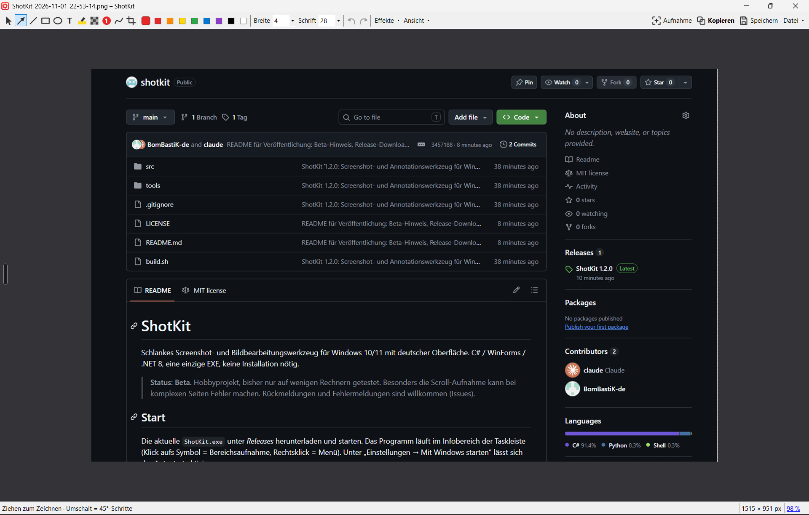

# ShotKit

Schlankes Screenshot- und Bildbearbeitungswerkzeug für Windows 10/11 mit deutscher Oberfläche.
C# / WinForms / .NET 8, eine einzige EXE, keine Installation nötig.

> **Status: Beta.** Hobbyprojekt, bisher nur auf wenigen Rechnern getestet. Besonders die Scroll-Aufnahme
> kann bei komplexen Seiten Fehler machen. Rückmeldungen und Fehlermeldungen sind willkommen (Issues).

## Screenshots



## Start

Die aktuelle `ShotKit.exe` unter *Releases* herunterladen und starten. Das Programm läuft im Infobereich der Taskleiste
(Klick aufs Symbol = Bereichsaufnahme, Rechtsklick = Menü). Unter „Einstellungen → Mit Windows starten“ lässt sich der Autostart aktivieren.

Beim ersten Start kann Windows SmartScreen warnen (unsignierte EXE): „Weitere Informationen → Trotzdem ausführen“.

## Tastenkürzel (global)

| Kürzel | Aufnahme |
|---|---|
| `Druck` | Bereich aufziehen **oder** Fenster anklicken (mit `Strg`: Unterelement) |
| `Strg+Druck` | Bildschirm unter dem Mauszeiger |
| `Strg+Umschalt+Druck` | Alle Bildschirme |
| `Umschalt+Druck` | Aktives Fenster |
| `Strg+Alt+Druck` | Scroll-Aufnahme (lange Seiten), siehe unten |
| `Strg+Umschalt+1/2/3/4` | Ausweichkürzel für Bereich / Bildschirm / Fenster / Scroll |

Windows 11 belegt `Druck` standardmäßig mit dem Snipping Tool. Dann unter
*Einstellungen → Barrierefreiheit → Tastatur → „Druck-Taste zum Öffnen der Bildschirmausschnitterstellung verwenden“* ausschalten
oder die Ausweichkürzel nutzen. Falls ein Kürzel belegt ist, meldet ShotKit das beim Start.

Im Aufnahme-Overlay: Lupe mit Pixelkoordinaten und Farbwert, Pfeiltasten verschieben den Mauszeiger um 1 px (mit Umschalt 10 px), `Enter` übernimmt das markierte Fenster, `Esc` bzw. Rechtsklick bricht ab.

## Scroll-Aufnahme

1. `Strg+Alt+Druck` (oder Tray-Menü „Scroll-Aufnahme“). Ein Klick wählt den Inhaltsbereich (Webseite/Dokument
   ohne Browserleisten, in Chrome/Edge/Word), `Strg`+Klick das ganze Fenster, oder Bereich selbst aufziehen.
2. Im Fenster neben dem roten Rahmen **Nach unten**, **Nach rechts** oder **Nach links** ankreuzen und **Start** klicken.
3. ShotKit scrollt per Mausrad in diese Richtung und setzt die Bilder zusammen, bis das Ende erreicht ist.
   `Esc` oder Maus bewegen stoppt vorzeitig – das bis dahin Aufgenommene bleibt erhalten.

Abgleich per Mehrheitsentscheid über Bänder à 40 Zeilen (robust gegen halbtransparente Kopfleisten,
Animationen, feste Seitenleisten). Nahtstellen liegen mittig zwischen zwei Aufnahmen, dadurch erscheinen
fixierte Leisten und Banner (z. B. Cookie-Hinweis) nur einmal ganz oben bzw. unten. Max. 30 000 px Länge.

Tipp: Cookie-Banner vorher wegklicken – sonst verdeckt es am Seitenende die letzten Zeilen.
Lässt sich ein Schritt nicht zuordnen, legt ShotKit unter `Bilder\ShotKit\Diagnose\` die beiden Bilder und Kennwerte ab.

## Editor

Werkzeuge (Taste in Klammern): Auswählen (V), Pfeil (A), Linie (L), Rechteck (R), Ellipse (E), Text (T),
Textmarker (M), Verpixeln (B), Schritt-Nummern (N), Freihand (P), Zuschneiden (C).

- Alle Objekte bleiben bearbeitbar: auswählen, verschieben, an Griffpunkten ändern, Farbe/Breite/Schrift nachträglich ändern, `Entf` löscht.
- `Umschalt` beim Zeichnen: 45°-Winkel bzw. Quadrat/Kreis. Pfeiltasten verschieben das gewählte Objekt.
- Effekte: Rahmen, Schlagschatten (transparent im PNG).
- `Strg+Z` / `Strg+Y` Rückgängig/Wiederholen, `Strg+C` Kopieren, `Strg+S` Speichern, `Strg+Umschalt+S` Speichern unter (PNG/JPG/BMP/GIF),
  `Strg+O` Öffnen, `Strg+V` Bild einfügen, `Strg+N` neue Aufnahme, `Strg+Mausrad` / `Strg+0` / `Strg+9` Zoom.

Nach jeder Aufnahme (einstellbar im Tray-Menü): Bild in die Zwischenablage, automatisch als PNG in
`Bilder\ShotKit` speichern, Editor öffnen. Einstellungen liegen in `%APPDATA%\ShotKit\settings.json`.

## Bauen

```bash
./build.sh          # erzeugt dist/ShotKit.exe (benötigt .NET 8 SDK, z. B. in ~/.dotnet)
```

Unter Windows alternativ: `dotnet publish src -c Release -o dist`.

`tools/make_icon.py` erzeugt `src/shotkit.ico` neu (reines Python, keine Abhängigkeiten).

## Nicht enthalten

Videoaufnahme, Texterkennung (OCR), Bibliothek mit Tags, Cloud-Teilen.

## Lizenz

MIT, siehe [LICENSE](LICENSE).
